# Large-Scale Terrain Data Analysis 2: Final Report

**Radar visibility, flight-route visibility and radar-hidden corridors over the Garhwal Himalaya**

Spatial Informatics · Final submission · November 2026

| Track | Topic | Owner |
|---|---|---|
| 1 | Radar visibility | Sravani |
| 2 | Flight-route visibility | Saloni |
| 3 | Radar-hidden corridor and QGIS plugin | Akshat |

Repository: <https://github.com/Saloni-go/Optics_Spatial> · Presentation: `presentation/Terrain_Visibility_Final.pdf`

---

## Summary

Three visibility problems were solved on one shared terrain, with one visibility model, and run as one pipeline:

- **Track 1** asks which ground, and which low-flying aircraft, six ridge-top radars can see.
- **Track 2** asks what an aircraft sees along its route, and what it misses.
- **Track 3** finds the route that keeps an aircraft hidden from those radars without a large detour, interactively, inside QGIS.

Each track was studied for computational complexity, memory, accuracy and visualisation performance.

| Result | Value |
|---|---|
| Ground seen by the six radars (120 × 120 km) | 16.7% |
| Area where an aircraft 150 m above ground is seen | 35.6% |
| Same six radars, better placed (greedy siting) | +29% coverage |
| Valley flight (300 m above ground): corridor seen | 26% |
| Cruise flight (5,500 m): corridor seen | 79% |
| Least-exposure route vs shortest route | 30% longer, 93% less exposure |
| Route from any start once the goal's field is built | 0.06 ms |
| Largest map tested | 64 M cells (240 × 240 km) |
| Runtime prediction error at 64 M (most methods) | within ±17% |
| Memory prediction error at 64 M | 0–13% |

**Main findings**

1. The fast viewshed methods (R2, GDAL) grow linearly with map size. The exact method grows as N^1.5 and takes about 52 minutes at 16 M cells, against 74 ms for GDAL.
2. Route visibility costs *positions × min(radius², map)*. This model fits the measurements within 5%.
3. Graph search on 16 M cells runs in 2.5 s with our C solver. Precomputing a cost-to-go field per goal makes every new start a lookup.
4. The tracks agree with each other: no route is ever detected where Track 1 says the radars cannot see.
5. At 64 M cells the scaling laws still hold. What can run is decided by memory, not time: SciPy's explicit graph would need about 24 GB.

---

## 1. Data and shared model

**Terrain.** Copernicus GLO-30 DSM, reprojected to UTM 44N (EPSG:32644) at 30 m. Square DEMs share one grid and one centre (Rudraprayag), so the coverage grows while the resolution stays fixed.

| DEM | Cells | Extent | Elevation | Used by |
|---|---|---|---|---|
| 500 × 500 | 0.25 M | 15 km | 594–2,856 m | all tracks |
| 1000 × 1000 | 1 M | 30 km | 547–3,022 m | all tracks |
| 2000 × 2000 | 4 M | 60 km | 485–4,480 m | all tracks |
| 4000 × 4000 | 16 M | 120 km | 315–7,074 m | all tracks, scenarios |
| 8000 × 8000 | 64 M | 240 km | built from 12 tiles | scale test only |

The 8000 map was built from 12 tiles. Its centre 4000 × 4000 window matches `dem_4000` to within 0.5 mm, so it is a strict extension of the team's maps.

**Visibility model, shared by every track:**
- radar masts 30 m above ground;
- aircraft 150 m above ground;
- 40 km radar range;
- Earth curvature with refraction (k = 1/7);
- six ridge-top radar sites, chosen by one rule: the highest point within 3 km, between 1,500 and 3,200 m, at least 22 km apart.

**Measurement.** Each benchmark is the median of 5 runs, each in a fresh process, with compute timed apart from I/O. Peak memory is the process high-water mark. Complexity is the slope of log(time) against log(cells). Accuracy is measured against synthetic terrains and exact references (agreement, Cohen's kappa, Jaccard, cost gap).

**Machines.**
- The team's integrated pipeline ran on an AMD Ryzen 9 7900X (24 threads, 31 GB, GDAL 3.13) in 69 minutes.
- The extensions and the 64 M test ran on a Linux laptop (12 threads, 15.3 GB, GDAL 3.4).

Results are kept in separate folders: `results/` (team PC), `results/linux/` (laptop extensions) and `results/linux64/` (64 M test).

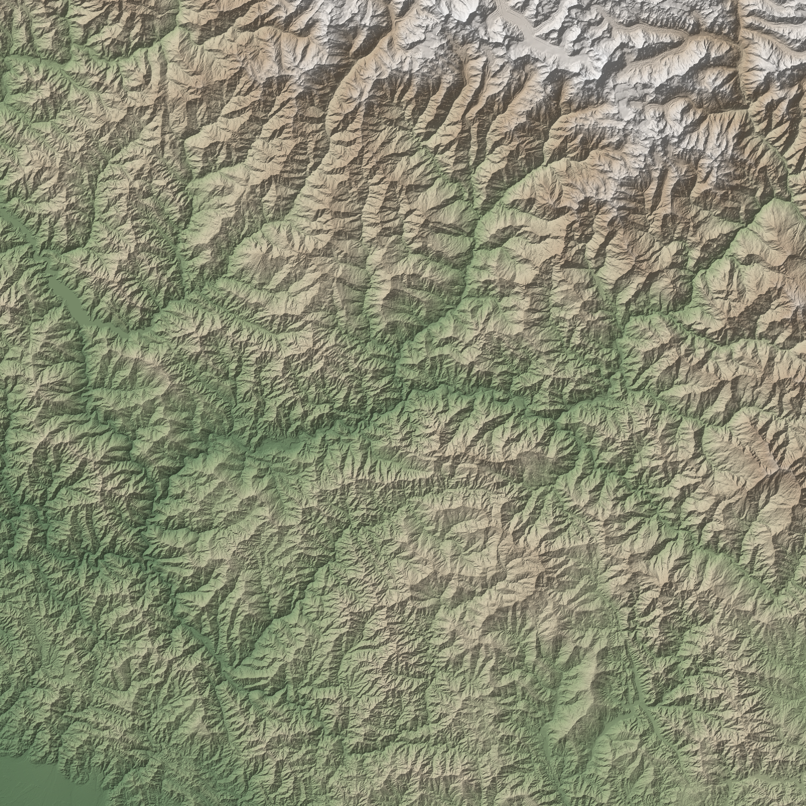

---

## 2. Track 1: radar visibility

### 2.1 Algorithms and validation

| Algorithm | Idea | Cost |
|---|---|---|
| Naive line of sight | sample the terrain profile to every cell; exact reference | O(N·√N) |
| R2 ray casting | one ray per boundary cell with a running horizon (own NumPy code) | O(N) |
| GDAL viewshed | C++ reference-plane algorithm | O(N) |

All three are 100% correct on synthetic terrains: flat, valley, wall and cone.

| On the real DEM, against the exact result | R2 | GDAL |
|---|---|---|
| Agreement | 99.9% | 99.8% |
| Kappa | 0.98 | 0.96 |

**R2 fix (final phase).** Several rays cross each cell. R2 used to call a cell visible if *any* of them saw it, so its errors went only one way: about 20× more falsely visible cells than falsely hidden ones, and a visible area about 8% too high. Now each cell takes the answer of the ray that passes closest to its centre:
- kappa rose from 0.96 to 0.98, above GDAL's;
- the visible area is within 1% of the exact result;
- R2 is about 1.6× slower than before.

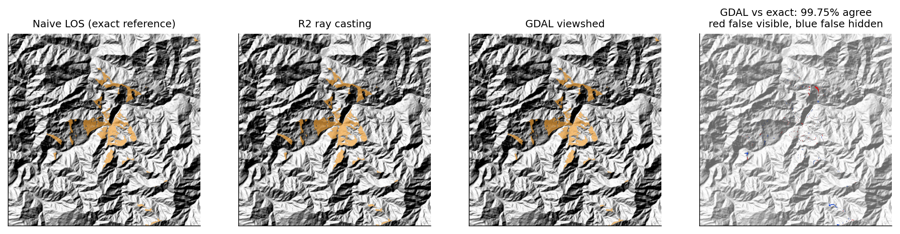

### 2.2 Scenario

The six radars see **16.7%** of the ground, and an aircraft 150 m above ground over **35.6%** of the area. Each single radar sees 4–14% of the ground within its 40 km range. The deep valleys hide most terrain even from ridge tops.

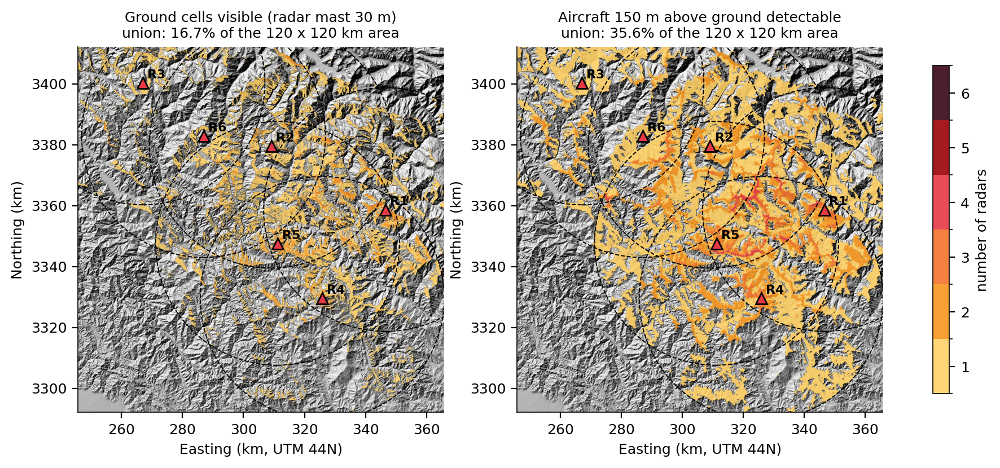

### 2.3 Complexity, parameters and optimisations

| Study (16 M cells) | Result |
|---|---|
| E1 map size | fitted slopes: naive 1.50, R2 0.94, GDAL 0.81 (theory 1.5, 1, 1). Exact method at 16 M: 51.6 min (projected); GDAL: 74 ms |
| E2 range 5 → 60 km | GDAL time grows as range^1.46 (the area grows as range²) |
| E3 mast height | changes coverage, not cost |
| E4 many radars | 12 threads are 4.2× faster at 16 radars; separate processes lose up to 8 radars to start-up |
| E5 read only the range window | same output, a fraction of the time and memory |
| E6 coarser DEM 60 / 90 / 120 m | kappa 0.90 / 0.83 / 0.78 against 30 m |

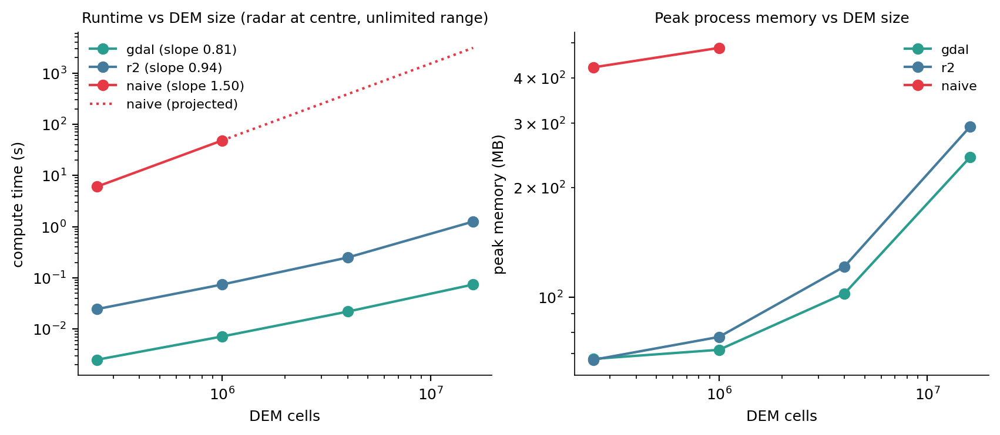

### 2.4 Extensions (laptop, `results/linux/radar_ext`)

**Lowest detectable altitude.** For every cell, the lowest height above ground at which at least one radar sees an aircraft. GDAL 3.4 has no direct mode for this, so it is a sweep over 15 heights: 90 viewsheds in 7.6 s.

| Aircraft height above ground | Share of the area where it is seen |
|---|---|
| 25 m | 22% |
| 150 m | 36% |
| 2,000 m | 79% (the rest is beyond the 40 km range) |

A 5-level sweep costs a third of the time but over-estimates the lowest altitude by about 160 m on average.

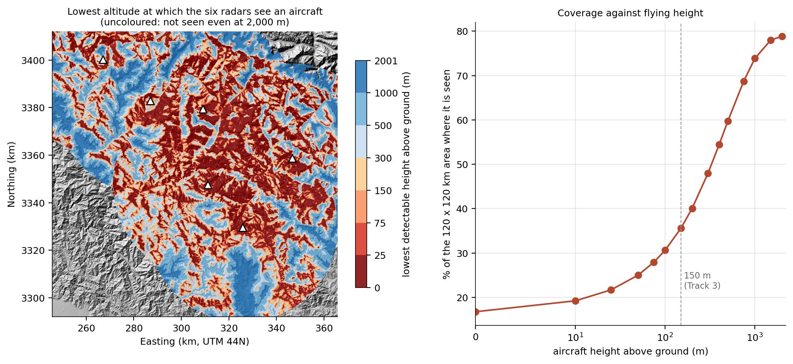

**Radar placement.** From 193 ridge-top candidates, radars were picked one at a time, each time adding the one that covers the most new area for an aircraft at 150 m.
- Six radars placed this way cover **6,624 km²**, against 5,122 km² for the shared sites (**+29%**).
- Five of them already match the shared six.
- The shared sites were picked highest-first, so several of them overlook the same valleys.

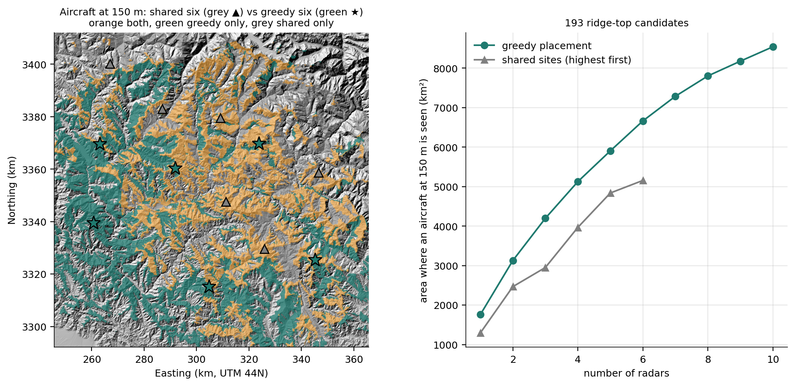

**Detection, DEM error and mast height.**
- *Detection:* with Track 3's detection model, line of sight covers 5,122 km², but the chance of detection is at least 50% per km flown on only 576 km².
- *DEM error:* over 20 runs with ±4 m correlated DEM noise, about 5% of the aircraft coverage and 8% of the ground coverage is uncertain, mostly on ridge edges.
- *Mast height:* raising the masts from 10 m to 100 m adds only 10–15% coverage. Where the radars stand matters more than how tall the masts are.

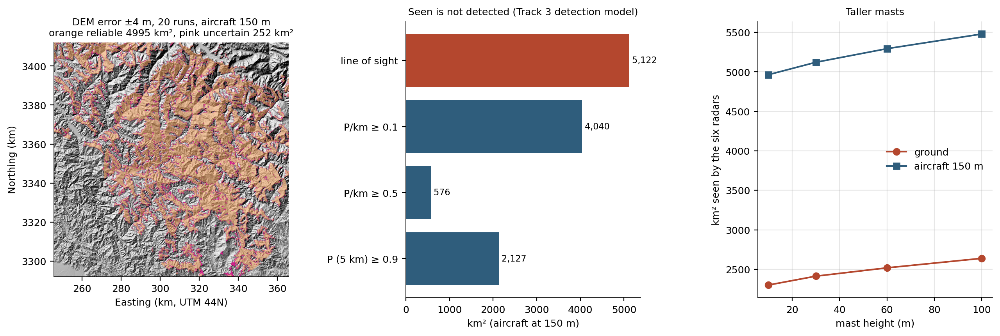

---

## 3. Track 2: flight-route visibility

### 3.1 Method and scenario

1. **Route:** 166 km up the Alaknanda valley, Devprayag → Joshimath (the least-elevation path between the towns).
2. **Altitude:** terrain-following 300 m above smoothed ground, or a 5,500 m cruise.
3. **Sampling:** a position every 1,000 m (167 positions), with a 20 km viewshed at each.
4. **Aggregation:** times seen per cell, first position that sees each cell, new area per position, and blind spots.

**Result.** The valley flight sees **1,537 km² (26%)** of the 6,024 km² corridor; the cruise sees **4,732 km² (79%)**. The 167 viewsheds take 2.9 s. The valley walls hide almost everything beyond the first ridge from a low aircraft: good for staying hidden, bad for surveillance. That trade-off is what Track 3 optimises.

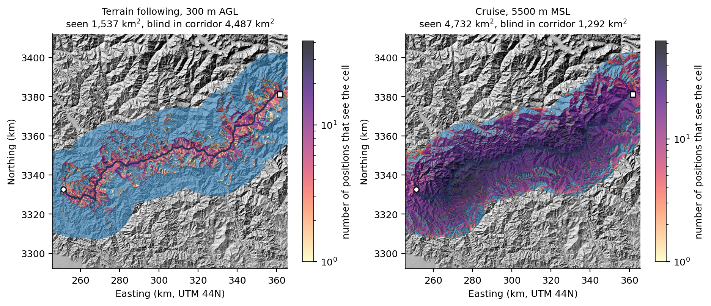

### 3.2 Complexity and optimisations

| Study | Result |
|---|---|
| F1 map and route grow together | 45 ms → 15.0 s, slope 1.39 (theory 1.5) |
| F1b fixed 12 km route | flat once the map is larger than the radius |
| F2 / F4 / F5 | linear in positions (0.98), about radius² (1.74), linear in route length (1.09) |
| F3 altitude | no cost change; coverage grows with height |
| F6 optimisation (333 viewsheds) | 15.7 s re-reading the DEM → 5.3 s cached → 4.2 s processes → 2.2 s threads, identical result |
| Sampling | adaptive refinement never beat fixed spacing. At cruise 4 km spacing keeps ~97% of coverage; valley flying needs ~500 m |

### 3.3 Extensions (laptop, `results/linux/flight`, details in `flight/TRACK2_EXTENSIONS.md`)

**1. Cheaper computation.**
- Each thread uses a shared zero-copy view of the DEM: 1.38 s instead of 1.92 s, with the same answer.
- A tiled accumulator cuts raster memory from 92 MB to 10 MB.
- A complexity model, T = a·W·min(πr², N) + b·W (W positions, radius r, map N cells), fits within 4.9%, with a = 11.4 ns per cell and b = 0.10 ms per position.

**2. A real sensor and uncertainty.**
- With field of view, depression limits, ground resolution and dwell time, a forward camera observes only 220 of the 1,600 km² in line of sight in the valley (5–18% depending on the sensor).
- Monte Carlo with DEM and position errors: "seen" is uncertain on 7.9% of the valley result and 1.7% at cruise.

**3. Six applications of the same engine.**

| Application | Result |
|---|---|
| Radio link to a town station | holds on 33% of the valley route; 100% at cruise |
| River / road coverage | following the valley sees all of the river |
| Search and rescue (0.5 m camera, 15 × 15 km) | 1 km track spacing covers 99.98% in 66 min |
| Flying height | 80% of the local view needs about 2 km above ground |
| Several aircraft | four aircraft see 5,644 km²; the fourth overlaps 62% with the others |
| Look-ahead | less than 20 s warning of terrain ahead on 3.4% of the valley route |

**4. Flight playback in QGIS.** Every cell stores the flight time at which it is first seen, so the QGIS Temporal Controller replays the flight at 17–23 frames per second. The 16 M-cell rasters draw in 23–69 ms.

**Scale test (Track 2).** The complexity model predicted the 64 M-cell run within −8%, and the other new runs within 8–22%. It under-predicts the 8000 map by about 20% because it has no map-size term.

---

## 4. Track 3: radar-hidden corridor

**Problem.** The map is a grid graph: 16 M cells, 8 neighbours each, 128 M edges. Each step costs *c = L · (1 + α · threat) + β · climb*, where the threat comes from Track 1's radar viewsheds, either as exposure or as a detection hazard −ln(1 − p) per km. The detection probability of a route is P = 1 − exp(−Σ length · hazard). This sum is additive, so every shortest-path method applies.

| Devprayag → Joshimath | Length | Exposed | Exposure |
|---|---|---|---|
| Shortest (α = 0) | 131 km | 39% | 31.5 |
| Track 2 valley route | 178 km | 26% | 26.5 |
| α = 10 | 170 km | 3% | 2.2 |
| α = 100 | 216 km | 1% | 0.5 |

| Solver, 16 M nodes, one route | Time | Peak memory |
|---|---|---|
| Dijkstra (Python) | 37.7 s | 682 MB |
| A* (Python) | 28.2 s | 1,031 MB |
| Dijkstra (SciPy) | 6.4 s | 6,025 MB |
| Multi-resolution ×4 (1.4% above optimum) | 2.1 s | 1,217 MB |
| Our C Dijkstra on the implicit grid | 2.5 s | 635 MB |

All exact solvers return the same optimum.

**What to precompute.** One backward search builds a cost-to-go field for a goal (0.28 s on 12 cores, 183 MB). After that, a route from any start is a lookup taking 0.06 ms. Landmarks (ALT) answer any start–goal pair in about 0.2 s.

**Interactive answers in the plugin:**

| Action | Latency |
|---|---|
| Change α | answered from a bank of precomputed fields in about 1 ms; the exact field follows in about 0.4 s |
| Drag a radar | that radar's viewshed plus a parallel field rebuild: about 0.6–0.9 s |
| Pan / zoom | recomputes only what is on screen, in 9–40 ms |

**Risk budget.** The shortest route whose detection probability stays under a budget is found by Lagrangian relaxation (LARAC) followed by an exact label search, with a certified lower bound. Example: 188 km at 49.8% detection.

**Memory.** Storing each next step as a 1-byte direction code cuts memory 4× and gives identical routes.

**Deliverable.** A QGIS plugin (Visibility Corridor) and Processing tools that expose the best algorithm of each track.

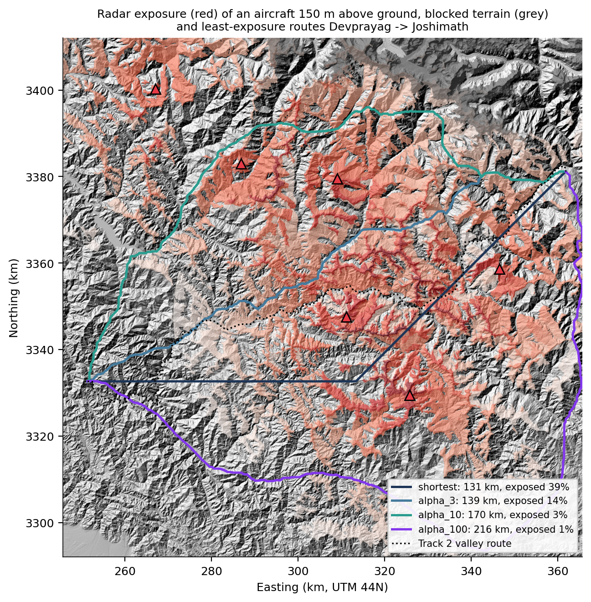

---

## 5. Integration across the tracks

| Check (16 M cells) | Result |
|---|---|
| Cells where Track 1 coverage = Track 3 hazard > 0 | 100.000% agree |
| Detection hazard outside coverage | 0 cells |
| Random paths fully outside coverage (of 5,000) | 195, maximum P(detect) 0.00% |

Every route is scored by every track. Hiding from the radars does not blind the aircraft: the least-covered route is detected with 35% probability, yet it sees 2,945 km² of ground, 2.4× more than the valley route.

| Track | Unit of work | Grows with | Exponent | Best lever |
|---|---|---|---|---|
| 1 Radar | one viewshed | cells in range | 0.72 | range window, threads |
| 2 Flight | viewshed per position | positions × radius² | 1.33 | threads, spacing per altitude |
| 3 Corridor | graph search | nodes (N log N) | 1.01 | C on the implicit grid, precompute |

**Visualisation performance.** In QGIS, plain or pyramided rasters draw in tens of milliseconds at any size. Compressed tiled GeoTIFFs without pyramids slow down as the raster grows at full extent, so pyramids should be built for compressed outputs.

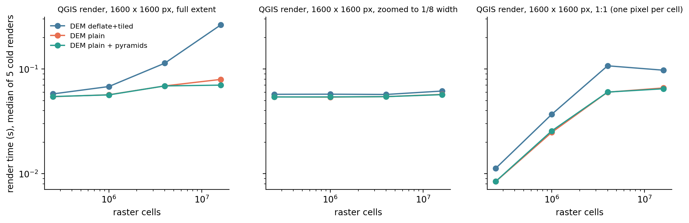

---

## 6. Scale test: 64 M cells, all three tracks

All three tracks were run at 0.25–64 M cells on the laptop. A power law t = c·N^b was fitted on the sizes up to 16 M (the team's largest map) and extended to 64 M. Memory was fitted as a straight line: a fixed base plus a constant number of bytes per cell.

| Method | 16 M → 64 M | 64 M time | Runtime prediction error | Peak memory |
|---|---|---|---|---|
| T1 GDAL viewshed | ×3.8 | 0.53 s | +5% | 0.8 GB |
| T1 R2 ray casting | ×6.0 | 17.8 s | −38% | 1.4 GB |
| T2 route grows with map | ×8.4 | 175 s | −10% | 1.5 GB |
| T2 fixed 12 km route | ×1.0 | 0.27 s | flat | 0.9 GB |
| T3 C Dijkstra | ×4.3 | 15.2 s | +2% | 2.5 GB |
| T3 C A* | ×4.3 | 13.8 s | −3% | 2.5 GB |
| T3 multi-resolution | ×3.0 | 8.8 s | 0% | 4.8 GB |
| T3 8 routes, C landmarks | ×3.8 | 71 s | +17% | 7.6 GB |
| T3 SciPy Dijkstra (explicit graph) | not run | — | — | ~24 GB predicted (laptop has 15.3 GB) |

**Findings.**
- **The scaling laws hold at 4× the largest map.** Most runtimes fall within ±17% of the trend, and memory within 0–13%.
- **Two exceptions grow faster than their trend.** R2's arrays no longer fit in the CPU cache. Track 2's route grows with the map, which adds a map-size cost.
- **Memory decides what can run.** The explicit graph costs about 387 bytes per cell, against about 39 for the C solvers, which do the same job in 15 s with 2.5 GB.

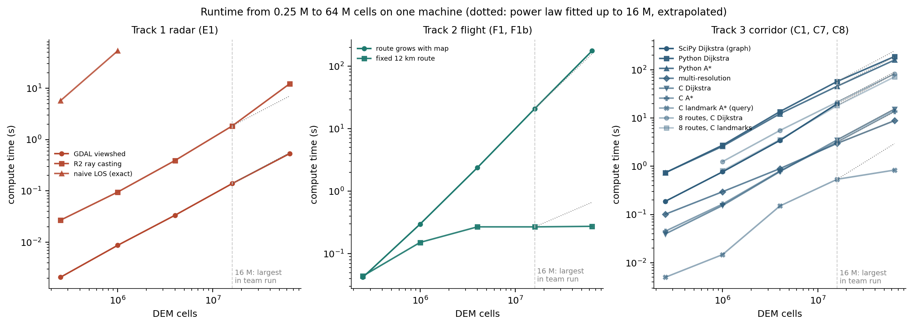

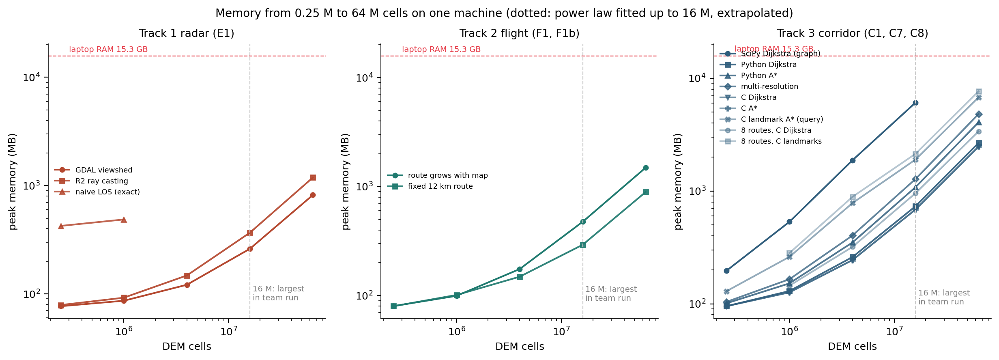

---

## 7. Conclusions and limitations

**Track 1.**
- Exact viewsheds cost N^1.5; R2 (with its bias fixed) and GDAL stay linear.
- Threads are the right way to run many radars.
- Where the radars are placed matters far more than mast height: 29% more coverage with the same six radars.
- Line of sight is not detection.

**Track 2.**
- Cost = positions × min(radius², map), predicted within 5%.
- Sharing the DEM across threads is the fastest exact method.
- Sample spacing should follow altitude.
- A real camera observes only a fraction of what is in line of sight.
- About 8% of a low-flight coverage map is uncertain.

**Track 3.**
- Precompute per goal, and every start becomes a lookup.
- Parallel C makes rebuilds take under a second.
- A certified risk budget.
- 4× less memory with direction codes.
- Shipped as a QGIS plugin with Processing tools.

**Across tracks.** One pipeline on one machine; detection consistent with coverage; every route scored by all three tracks; scaling laws checked up to 64 M cells.

**Limitations.**
- One region and one DEM source; the DSM includes trees and buildings.
- The radar model is line of sight with a distance-based detection probability: no radar cross-section, clutter or multipath.
- The plugin is Windows-only, because the solver ships as a DLL; the code also builds on Linux.
- The 64 M test ran on one laptop. SciPy's graph method and the Python landmark method did not fit in its memory.

---

## 8. Reproducing the results

```bash
# team pipeline (Windows): every track, every benchmark
run.bat -m integration.pipeline
# Linux laptop
export PYTHONNOUSERSITE=1 PYTHONPATH="$PWD"
OPTICS_RESULTS=results/linux python3 -m radar.extensions        # Track 1 extensions
OPTICS_RESULTS=results/linux64 OPTICS_BENCH_SIZES=500,1000,2000,4000,8000 python3 -m radar.benchmark E1
python3 scripts/prepare_8000.py                                 # 64 M-cell DEM
OPTICS_RESULTS=results/linux64 python3 -m integration.scale64m  # 64 M analysis
```

Details: `README.md`, `radar/TRACK1_EXTENSIONS.md`, `flight/TRACK2_EXTENSIONS.md`, `integration/README.md`, `qgis_plugin/README.md`.

## References

1. Franklin, W. R. & Ray, C. (1994). Higher isn't necessarily better: visibility algorithms and experiments. *Advances in GIS Research*.
2. Wang, J., Robinson, G. J. & White, K. (2000). Generating viewsheds without using sightlines. *Photogrammetric Engineering & Remote Sensing* 66(1).
3. Goldberg, A. V. & Harrelson, C. (2005). Computing the shortest path: A* search meets graph theory (ALT). *SODA*.
4. Delling, D., Goldberg, A. V., Pajor, T. & Werneck, R. F. (2011). Customizable route planning. *SEA*.
5. Carlyle, W. M., Royset, J. O. & Wood, R. K. (2008). Lagrangian relaxation and enumeration for solving constrained shortest-path problems. *Networks* 52(4).
6. Meyer, U. & Sanders, P. (2003). Δ-stepping: a parallelizable shortest path algorithm. *Journal of Algorithms* 49(1).
7. European Space Agency (2021). Copernicus DEM GLO-30. doi:10.5270/ESA-c5d3d65.
8. GDAL/OGR contributors. GDAL viewshed (gdal_viewshed). <https://gdal.org>.
